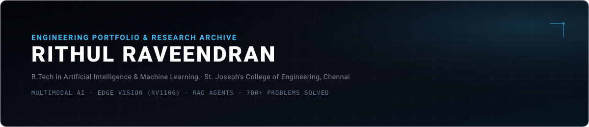
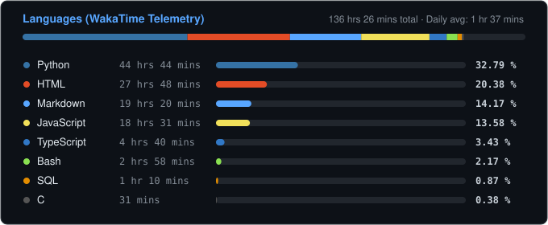

<!-- Banner -->

  

<!-- Floating Developer Mascot / Illustration -->

  

<!-- Header Name & Intro -->
#  ɪ'ᴍ ʀɪᴛʜᴜʟ! 
*AI &amp; Machine Learning Engineer · Systems Builder*
  

I am a second-year B.Tech student in <strong>Artificial Intelligence and Machine Learning</strong> at <strong>St. Joseph's College of Engineering, Chennai</strong>, and an alumnus of <strong>Sainik School Kazhakootam</strong>.

- 🎙️ **Multimodal AI &amp; Speech:** Audio characteristic extraction (`librosa`) combined with agentic decision graphs (`LangGraph`, `pgvector`).
- 👁️ **Edge Computer Vision:** On-device YOLO models deployed on embedded hardware (`Luckfox Pico Pro Max RV1106`).
- ⚡ **Competitive Problem Solving:** **700+ problems solved** across LeetCode, SkillRack, CodeChef, and Codeforces.
- 🏆 **Hackathons:** 1st Place Winner at **Makeathon 2.0** and **Makeathon 3.0**.
- 💻 Visit my [Interactive Portfolio](https://rithulraveendran.github.io/) for live telemetry and project schematics.

<!-- Profile Views & Live Portfolio Badge -->

  
  

<!-- Animated Terminal Typing Engine -->

  

 

---

<!-- Technologies & Tooling -->
<h2 align="center">🛠️ Tᴇᴄʜ Sᴛᴀᴄᴋ &amp; Tᴏᴏʟɪɴɢ 🛠️</h2>

  

 

<!-- GitHub Trophies & Official Achievements -->
<h2 align="center">🏆 Gɪᴛʜᴜʙ Tʀᴏᴘʜɪᴇs &amp; Aᴄʜɪᴇᴠᴇᴍᴇɴᴛs 🏆</h2>

  

  
  &nbsp;&nbsp;&nbsp;&nbsp;
  
  &nbsp;&nbsp;&nbsp;&nbsp;
  

 

<!-- Competitive Programming -->
<h2 align="center">⚡ Cᴏᴍᴘᴇᴛɪᴛɪᴠᴇ Pʀᴏɢʀᴀᴍᴍɪɴɢ ⚡</h2>

  

 

<!-- GitHub Stats & Streak Table -->
<h2 align="center">📊 Gɪᴛʜᴜʙ Sᴛᴀᴛs &amp; Sᴛʀᴇᴀᴋ 📊</h2>

<table width="100%">
  <tr>
    <td width="50%" align="center">
      <h3 align="center"><strong>Gɪᴛʜᴜʙ Sᴛᴀᴛs</strong></h3>
      

        
      

    </td>
    <td width="50%" align="center">
      <h3 align="center"><strong>Sᴛʀᴇᴀᴋ Sᴛᴀᴛs</strong></h3>
      

        
      

    </td>
  </tr>
</table>

 

<!-- Contribution Activity Graph -->
<h2 align="center">📈 Cᴏɴᴛʀɪʙᴜᴛɪᴏɴ Gʀᴀᴘʜ 📈</h2>

  

 

<!-- Languages & WakaTime Telemetry -->
<h2 align="center">⏱️ WᴀᴋᴀTɪᴍᴇ Lᴀɴɢᴜᴀɢᴇ Tᴇʟᴇᴍᴇᴛʀʏ ⏱️</h2>

  

 

<!-- Connect With Me -->
<h2 align="center">🤝 Cᴏɴɴᴇᴄᴛ Wɪᴛʜ Mᴇ 🤝</h2>

  
  
  
  
  
  
  

 

<!-- Footer Banner -->

  

