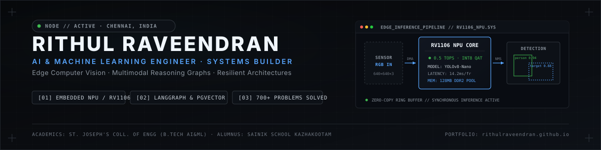
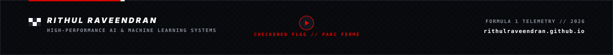

<!-- Header Graphic -->

  

<!-- Identity -->

  <h2><strong>RITHUL RAVEENDRAN</strong></h2>
  

    <strong>AI &amp; Machine Learning Engineer · Systems Architect</strong> 
    B.Tech in Artificial Intelligence &amp; Machine Learning at <strong>St. Joseph's College of Engineering, Chennai</strong> 
    Alumnus of <strong>Sainik School Kazhakootam</strong>
  

  

    
    &nbsp;
    
    &nbsp;
    
  

---

### Engineering Focus

* **Multimodal Speech & Acoustic Intelligence**  
  Audio characteristic extraction and acoustic feature engineering with `librosa`, combined with representation learning, spectrogram analysis, and multimodal reasoning systems.

* **Agentic Workflows & High-Dimensional Semantic Retrieval**  
  Stateful decision graphs and autonomous tool dispatching with `LangGraph`, backed by low-latency vector search using `pgvector` on `PostgreSQL`.

* **High-Performance Distributed Backends**  
  Scalable, asynchronous microservices and APIs engineered with `FastAPI`, `Flask`, `Docker`, and `Linux`. Built for high throughput, resilient data pipelines, and clean modular boundaries.

* **Hackathons & Competitions**  
  **1st Place Winner** at **Makeathon 2.0** and **Makeathon 3.0**.

---

### Technical Stack

| Category | Technologies |
| :--- | :--- |
| **Languages** | `Python` · `C` · `C++` · `TypeScript` · `SQL` · `Bash` |
| **AI / ML & Machine Intelligence** | `PyTorch` · `OpenCV` · `LangGraph` · `Librosa` · `pgvector` · `Hugging Face` |
| **Backend & Databases** | `FastAPI` · `Flask` · `PostgreSQL` · `SQLite` · `Docker` · `Linux (Ubuntu/Debian)` |
| **Developer Tools** | `Git` · `GitHub` · `VS Code` · `Postman` |

 

  

---

### Telemetry & Activity

  <table border="0" cellspacing="0" cellpadding="0">
    <tr>
      <td align="center" valign="middle">
        
      </td>
      <td width="20"></td>
      <td align="center" valign="middle">
        
      </td>
    </tr>
  </table>

 

#### Contribution Activity

  

---

### Development Telemetry (WakaTime)

  

---

### Connect

| Platform | Link | Focus |
| :--- | :--- | :--- |
| **Portfolio** | [rithulraveendran.github.io](https://rithulraveendran.github.io/) | Interactive Portfolio & Live Telemetry |
| **LinkedIn** | [linkedin.com/in/rithulraveendran](https://www.linkedin.com/in/rithulraveendran/) | Professional & Research Networking |
| **GitHub** | [@rithulraveendran](https://github.com/rithulraveendran) | Repositories & Open Source Systems |

 

<!-- Footer Graphic -->

  

