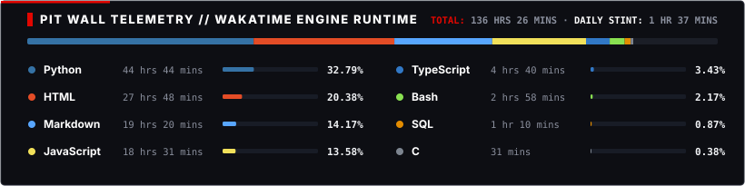

<!-- Header Graphic -->

  

<!-- Identity & Executive Summary -->

  <h3><strong>Rithul Raveendran</strong></h3>
  

    <strong>AI &amp; Machine Learning Engineer · Systems Builder</strong> 
    Second-Year B.Tech in Artificial Intelligence &amp; Machine Learning at <strong>St. Joseph's College of Engineering, Chennai</strong> 
    Alumnus of <strong>Sainik School Kazhakootam</strong>
  

  

    
    
    
    
  

---

### 🏛️ Core Engineering Disciplines

* **Edge Computer Vision & Embedded Acceleration**  
  Deploying quantized YOLO models onto embedded silicon (`Luckfox Pico Pro Max RV1106` / Rockchip NPU). Specializing in model compression, INT8 quantization-aware training (QAT), DMA zero-copy ring buffers, and sub-15ms real-time visual inference on resource-constrained platforms.

* **Multimodal AI & Agentic Decision Graphs**  
  Engineering audio characteristic extraction pipelines (`librosa`) integrated with stateful graph orchestration (`LangGraph`) and high-dimensional semantic search (`pgvector` on `PostgreSQL`).

* **Systems Architecture & Algorithmic Foundations**  
  Designing high-throughput asynchronous services using `FastAPI`, `Flask`, and `Docker`. **700+ algorithmic problems solved** across competitive programming platforms; 1st Place Winner at **Makeathon 2.0** and **Makeathon 3.0**.

---

### 🛠️ Technical Tooling & Stack

| Domain | Systems & Technologies |
| :--- | :--- |
| **Languages** | `Python` · `C` · `C++` · `TypeScript` · `SQL` · `Bash` |
| **AI / ML & Computer Vision** | `PyTorch` · `YOLOv8 / v11` · `OpenCV` · `LangGraph` · `Librosa` · `Hugging Face` |
| **Backend & Infrastructure** | `FastAPI` · `Flask` · `PostgreSQL` · `pgvector` · `SQLite` · `Docker` · `Linux (Ubuntu/Debian)` |
| **Hardware & Embedded** | `Luckfox Pico RV1106 (Rockchip ARM / RISC-V NPU)` · `Git` · `VS Code` · `Postman` |

 

  

---

### 📊 GitHub Activity & Telemetry

  <table border="0" cellspacing="0" cellpadding="0">
    <tr>
      <td align="center" valign="middle">
        
      </td>
      <td width="20"></td>
      <td align="center" valign="middle">
        
      </td>
    </tr>
  </table>

 

#### Contribution Activity

  

---

### ⏱️ WakaTime Language Telemetry

  

---

### ⚡ Competitive Problem Solving

  <strong>700+ Algorithmic Problems Solved</strong> Across Platforms (LeetCode, SkillRack, CodeChef, Codeforces) 
  1st Place Winner — Makeathon 2.0 &amp; Makeathon 3.0

  

---

### 🤝 Connect & Network

| Channel | Endpoint / Handle | Focus |
| :--- | :--- | :--- |
| **Interactive Portfolio** | [rithulraveendran.github.io](https://rithulraveendran.github.io/) | Project Schematics & Live Telemetry |
| **LinkedIn** | [linkedin.com/in/rithulraveendran](https://www.linkedin.com/in/rithulraveendran/) | Professional & Research Inquiries |
| **GitHub** | [@rithulraveendran](https://github.com/rithulraveendran) | Open Source & Systems Code |
| **LeetCode** | [@rithulraveendran](https://leetcode.com/u/rithulraveendran/) | Algorithms & Data Structures |
| **Codeforces** | [@rithulraveendran](https://codeforces.com/profile/rithulraveendran) | Competitive Contests |
| **CodeChef** | [@rithulr86](https://www.codechef.com/users/rithulr86) | Competitive Problem Solving |
| **Direct Email** | [iamrithulr@gmail.com](mailto:iamrithulr@gmail.com) | Engineering & Research Opportunities |

 

<!-- Footer Graphic -->

  

